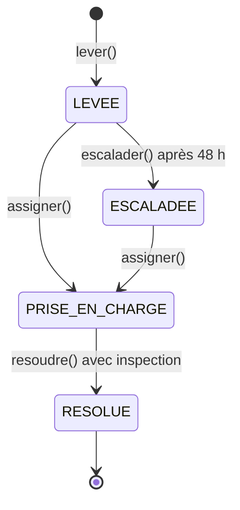

# Agrégat Alerte — Spécialité Développement

## 1. Responsabilité de l'agrégat

L'agrégat `Alerte` représente une alerte détectée pour une ruche. Il contrôle son cycle de vie, valide les règles métier et produit les événements correspondant aux changements d'état.

Il encapsule son état courant et la liste des événements en attente de publication.

## 2. Diagramme des états

Les états métier sont `LEVÉE`, `ESCALADÉE`, `PRISE_EN_CHARGE` et `RÉSOLUE`.

Une alerte escaladée peut encore être prise en charge. Une alerte résolue ne peut plus subir de transition.

## 3. Invariants métier

- Le type de risque doit appartenir aux types autorisés : `ESSAIMAGE`, `AFFAIBLISSEMENT`, `STRESS_THERMIQUE` ou `MORTALITE`.
- La confiance doit être un nombre fini compris entre 0 et 1 inclus.
- Une alerte doit être prise en charge avant de pouvoir être résolue.
- Une inspection doit être indiquée pour résoudre une alerte.
- Une alerte ne peut être escaladée qu'après 48 heures de retard.
- Une alerte résolue ne peut plus être assignée, escaladée ou résolue à nouveau.
- Une alerte déjà prise en charge ne peut pas être assignée ou escaladée une seconde fois.

## 4. Événements métier

| Événement | Déclencheur |
|---|---|
| `AlerteLevée` | Création d'une alerte valide |
| `AlertePriseEnCharge` | Assignation à une apicultrice ou un apiculteur |
| `AlerteEscaladée` | Escalade d'une alerte en retard |
| `AlerteRésolue` | Résolution après prise en charge et indication d'une inspection |

Les événements transportent les informations utiles, notamment l'identifiant de l'alerte et celui de la ruche. L'agrégat conserve les événements produits jusqu'à leur récupération par `pullEvents()`, qui les consomme une seule fois.

## 5. Implémentation du pattern State

Chaque état est représenté par une classe dédiée : `Levee`, `Escaladee`, `PriseEnCharge` et `Resolue`.

Les opérations `assigner()`, `escalader()` et `resoudre()` délèguent le comportement à l'état courant. Cette conception évite un `switch` centralisé sur le statut et permet de regrouper les règles de transition avec chaque état.

## 6. Place dans la carte des contextes

L'agrégat appartient au contexte métier de gestion des alertes de QueenBee.

- **En amont :** le système de détection ou de prédiction fournit les informations nécessaires à la levée d'une alerte.
- **Au centre :** l'agrégat `Alerte` garantit la cohérence du cycle de vie de l'alerte.
- **En aval :** les services applicatifs, le mécanisme de publication d'événements et le processus d'inspection peuvent exploiter les changements d'état.

Le service applicatif orchestre les opérations et la persistance via le dépôt. L'agrégat reste responsable des règles métier et ne dépend pas du mécanisme de stockage ou du bus d'événements.
